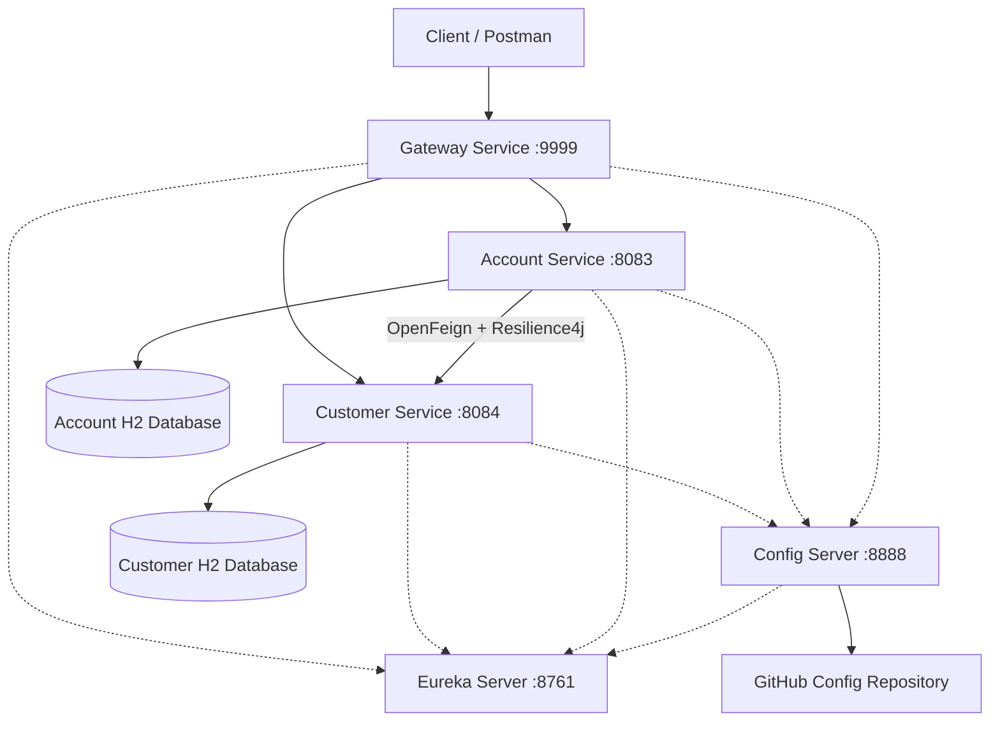

# TP01 — Spring Cloud Microservices Architecture

## Description

This project demonstrates the development of a microservices-based banking application using Spring Boot and Spring Cloud.

The application manages customers and bank accounts while demonstrating service discovery, centralized configuration, API Gateway routing, inter-service communication, and fault tolerance.

## Technologies Used

- Java 17
- Spring Boot 3.1.5
- Spring Cloud 2022.0.4
- Spring Cloud Config Server
- Netflix Eureka Server
- Spring Cloud Gateway
- Spring Data JPA
- H2 Database
- OpenFeign
- Resilience4j
- Spring Boot Actuator
- Maven

## Microservices

| Microservice | Port | Description |
|---|---|---|
| Discovery Service | 8761 | Registers and discovers microservices using Eureka |
| Config Service | 8888 | Provides centralized configuration from GitHub |
| Gateway Service | 9999 | Routes requests to registered microservices |
| Customer Service | 8084 | Manages customer information |
| Account Service | 8083 | Manages bank accounts and communicates with Customer Service |

## Configuration Repository

Centralized configuration files are stored in a separate GitHub repository:

[msa-bank-config](https://github.com/oussama-el-moqadem/msa-bank-config)

## Main Features

- Microservice registration and discovery
- Centralized configuration management
- Dynamic API routing
- Customer management through REST APIs
- Bank account management
- Inter-service communication with OpenFeign
- Fallback mechanism with Resilience4j
- Dynamic configuration refresh using Spring Boot Actuator


## Architecture


## How to Run the Application

### Prerequisites

Before running the project, make sure you have installed:

- Java JDK 17
- Maven (or use the included Maven Wrapper)
- IntelliJ IDEA or another Java IDE
- Git
- An internet connection to access the GitHub configuration repository

### Startup Order

Start the five microservices in the following order:

1. **Discovery Service** — Port `8761`
2. **Config Service** — Port `8888`
3. **Customer Service** — Port `8084`
4. **Account Service** — Port `8083`
5. **Gateway Service** — Port `9999`

Wait until each service starts successfully before launching the next one.

### Running with IntelliJ IDEA

1. Open the project in IntelliJ IDEA.
2. Import each microservice as a Maven project.
3. Open the corresponding main class.
4. Run each application in the recommended startup order.

| Microservice | Main Class |
|---|---|
| Discovery Service | `DiscoveryServiceApplication.java` |
| Config Service | `ConfigServiceApplication.java` |
| Customer Service | `CustomerServiceApplication.java` |
| Account Service | `AccountServiceApplication.java` |
| Gateway Service | `GatewayServiceApplication.java` |

### Running with Maven Wrapper

On Windows, open a terminal inside each microservice directory and execute:

```powershell
.\mvnw.cmd spring-boot:run
```

Start each microservice in a separate terminal, following the recommended order.

### Verify the Services

Once all microservices are running, open:

- **Eureka Dashboard:** http://localhost:8761
- **Config Server:** http://localhost:8888/customer-service/default
- **Customer API:** http://localhost:8084/customers
- **Account API:** http://localhost:8083/api/accounts
- **Customer API via Gateway:** http://localhost:9999/CUSTOMER-SERVICE/customers
- **Account API via Gateway:** http://localhost:9999/ACCOUNT-SERVICE/api/accounts

The Eureka Dashboard should display the registered microservices.

## REST API Endpoints

The application exposes REST APIs for managing customers and bank accounts.

### Customer Service API

Base URL: `http://localhost:8084`

| Method | Endpoint | Description |
|---|---|---|
| GET | `/customers` | Retrieve all customers |
| GET | `/customers/{id}` | Retrieve a customer by ID |
| GET | `/configTest` | Display customer service configuration values |

#### Example: Retrieve All Customers

Request:

```http
GET http://localhost:8084/customers
```

Example response:

```json
[
  {
    "id": 1,
    "firstName": "Mohammadi",
    "lastName": "Imane",
    "email": "imane@gmail.com"
  },
  {
    "id": 2,
    "firstName": "Ismaili",
    "lastName": "Aymane",
    "email": "aymane@gmail.com"
  }
]
```

### Account Service API

Base URL: `http://localhost:8083`

| Method | Endpoint | Description |
|---|---|---|
| GET | `/api/accounts` | Retrieve all bank accounts |
| GET | `/api/accounts/{id}` | Retrieve an account with its customer information |

#### Example: Retrieve All Bank Accounts

Request:

```http
GET http://localhost:8083/api/accounts
```

Each bank account contains information such as:

- Account ID (UUID)
- Balance
- Creation date
- Account type (`CURRENT_ACCOUNT` or `SAVING_ACCOUNT`)
- Currency
- Customer ID

#### Example: Retrieve an Account by ID

Request:

```http
GET http://localhost:8083/api/accounts/{id}
```

Replace `{id}` with an existing bank account UUID.

The response includes bank account details and customer information retrieved through OpenFeign.

### API Gateway

The API Gateway provides a single entry point for accessing the microservices.

Base URL: `http://localhost:9999`

| Method | Endpoint | Description |
|---|---|---|
| GET | `/CUSTOMER-SERVICE/customers` | Retrieve customers through the Gateway |
| GET | `/CUSTOMER-SERVICE/customers/{id}` | Retrieve a customer through the Gateway |
| GET | `/ACCOUNT-SERVICE/api/accounts` | Retrieve accounts through the Gateway |
| GET | `/ACCOUNT-SERVICE/api/accounts/{id}` | Retrieve an account with customer details |

### Dynamic Configuration Refresh

The configuration of Customer Service can be refreshed without restarting the application.

Request:

```http
POST http://localhost:8084/actuator/refresh
```

After refreshing, check the updated configuration:

```http
GET http://localhost:8084/configTest
```

Example response:

```json
{
  "defaultLanguage": "French",
  "defaultCurrency": "EUR",
  "defaultLocation": "Paris"
}
```

### Fault Tolerance with Resilience4j

If Customer Service becomes unavailable, Account Service uses a fallback mechanism.

The fallback customer information is:

```json
{
  "id": 1,
  "firstName": "Source not available",
  "lastName": "Source Not Available"
}
```

This mechanism improves the resilience of the application when an inter-service communication fails.